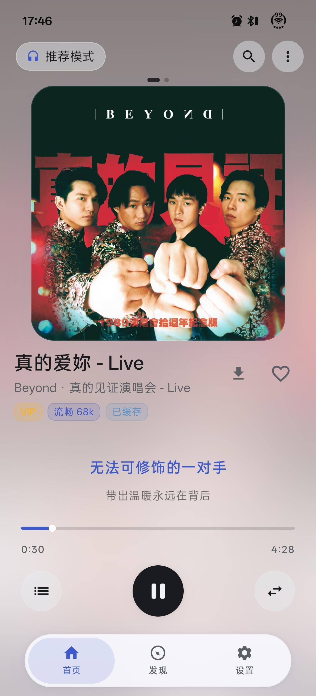
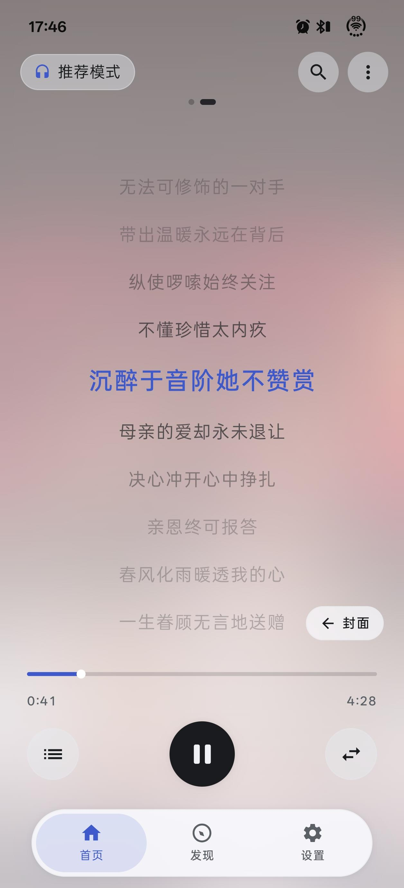
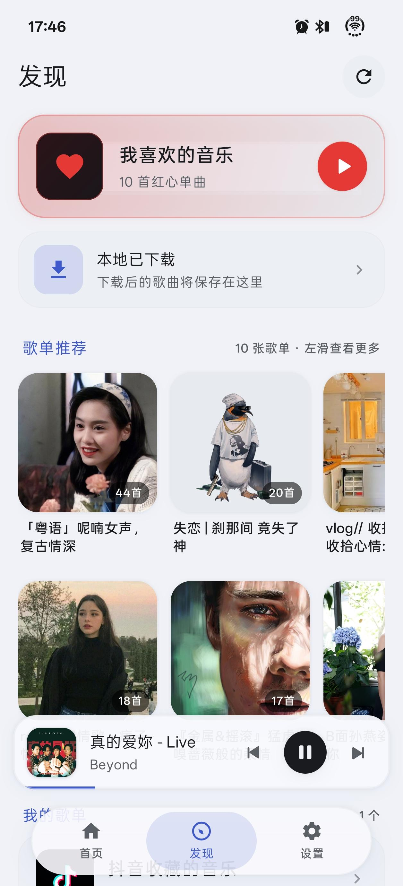

<div align="center">
  
  <h1>SodaM Mobile</h1>
  <p>基于 Jetpack Compose + Rust（<code>sodam-ffi</code>）的原生汽水音乐 Android 客户端</p>
  <p>
    <a href="LICENSE"></a>
    
    
    
    <a href="https://www.rust-lang.org/"></a>
  </p>
  <p>
    核心音乐引擎复用自上游 <a href="https://github.com/sodahub-org/sodam">sodahub-org/sodam</a>；
    接口与解密能力来自 <a href="https://github.com/sodahub-org/libresoda">libresoda</a>；
    应用签名服务可对接 <a href="https://github.com/sodahub-org/libmssdk">libmssdk</a>。
  </p>
  <p>
    <a href="PRIVACY.md">隐私政策</a> ·
    <a href="CONTRIBUTING.md">参与贡献</a> ·
    <a href="docs/ARCHITECTURE.md">架构文档</a> ·
    <a href="https://github.com/sodahub-org/sodam">上游桌面端仓库</a>
  </p>
</div>

**SodaM Mobile** 是面向 Android 设备的第三方汽水音乐客户端（`minSdk 26` / `targetSdk 36`，默认 `arm64-v8a`）。应用采用 **Jetpack Compose + Material 3 + Media3** 构建原生移动端交互，并通过 **UniFFI（`sodam-ffi`）** 直接调用 Rust 领域层 [`sodam-core`](crates/sodam-core) 与 [`libresoda`](https://github.com/sodahub-org/libresoda)，兼顾流畅的移动端手势体验、无损音质取流与稳定的本地/离线播放能力。

> **非官方项目声明**：本项目由社区开发维护，与汽水音乐官方无关；账号登录、歌单与曲库服务均来自汽水音乐官方接口。

---

## 界面预览

<div align="center">
  <table>
    <tr>
      <td align="center" width="33%">
        <br>
        <sub><b>播放主页</b> · 动态渐变与悬浮底栏</sub>
      </td>
      <td align="center" width="33%">
        <br>
        <sub><b>全屏歌词</b> · 横滑直达与胶囊返回</sub>
      </td>
      <td align="center" width="33%">
        <br>
        <sub><b>发现页</b> · 两行歌单与离线入口</sub>
      </td>
    </tr>
  </table>
</div>

---

## 核心特性

### 沉浸式全屏播放体验
- **Edge-to-Edge 全屏动态背景**：内容自然延伸至状态栏与系统导航栏区域；基于当前播放歌曲封面实时提取主色生成动态渐变背景（兼容 Android 8–16），并可在设置页自由调节动态背景浓度。
- **手势切歌与歌词联动**：
  - 首页支持上下滑动切歌并保留封面视差动效，配备极简双点翻页指示器与封面加载呼吸淡入占位；
  - 首页向右横滑直接进入全屏歌词页，右下角提供「封面」返回胶囊按钮；
  - 点击首页歌名直达所属专辑页，点击歌手名直达歌手详情页，点击音质标签直达设置页。

### 可定制播控与交互细节
- **4 种可热切换播放按钮动效（`PlayButtonStyle`）**：支持在设置或主题页实时切换「环绕进度（`ProgressRing`）」「磨砂呼吸（`FrostedPulse`）」「宽胶囊态（`CapsuleMorph`）」「纯粹高反差（`MinimalContrast`）」。
- **流体细轨进度条（`FluidSeekBar`）**：拖拽与播放状态平滑过渡，响应跟手。
- **切歌触感震动微调**：支持在设置页对切歌触感反馈强度进行分级调节或关闭。

### 双风格底部导航栏
- **简洁模式**：悬浮胶囊样式底部导航栏，支持长按后左右滑动丝滑切换页面。
- **Material You 模式**：固定贴合底部并与首页动态渐变背景自然融合，页面切换带有 `Crossfade` 过渡动画。

### 发现、搜索与离线下载管理
- **发现与歌单浏览**：支持「我喜欢的音乐」实时曲数校准同步、两行整体横滑推荐歌单网格，以及「本地已下载」离线管理视图（自动校验物理文件存在性，及时同步外部删除状态）。
- **单曲与批量下载**：单曲三点菜单整合「喜欢 / 取消喜欢」与「下载当前音质」，歌单与专辑支持批量下载；设置页可通过系统目录选择器（SAF）自定义下载保存路径。
- **即时音质切换**：在设置页切换音质档位后即时重取流生效，无需重启应用。
- **搜索与后台播放**：支持持久化搜索历史胶囊（单条删除与一键清空），并依托 Media3 `ExoPlayer` 与 `MediaSession` 提供后台播放、通知栏及锁屏控制。

---

## 架构与目录

```text
SodaM Mobile
├── android/                  Jetpack Compose + Material 3 + Media3 原生应用
│   └── app/src/main/         界面、播放器控制、下载器与 UniFFI Kotlin 绑定
├── crates/sodam-ffi/         UniFFI 桥接层，编译产物为 libsodam_ffi.so 与 Kotlin 绑定
└── crates/sodam-core/        配置、会话、队列、音乐库与音频流封装（纯 Rust）
    └── libresoda             汽水接口、取流、解密与扫码登录
        └── libmssdk          外部可选应用签名服务，用于完整音质链路
```

| 路径 | 说明 |
| --- | --- |
| [`android/`](android/) | Android Gradle 工程（`org.sodahub.sodam`，Java 17，Jetpack Compose） |
| [`crates/sodam-ffi/`](crates/sodam-ffi/) | 面向 Android 的 Rust FFI 导出层与 `uniffi-bindgen` 生成入口 |
| [`crates/sodam-core/`](crates/sodam-core/) | 与上游共享的核心业务逻辑层 |
| [`scripts/android-ffi.sh`](scripts/android-ffi.sh) | 交叉编译 `libsodam_ffi.so` 并同步 Kotlin 绑定的自动化脚本 |

---

## 构建与安装

### 环境要求
- **Android 打包**：JDK 17、Android SDK（Platform 36）、Android Gradle 插件环境（工程内含 `./gradlew`）。
- **Rust FFI 重编（仅改动 Rust 层或首次拉取未包含 `.so` 时需要）**：
  - Rust `stable`（`1.85+`）及对应 Android target（如 `aarch64-linux-android`）
  - [`cargo-ndk`](https://github.com/bbqsrc/cargo-ndk) 与完整版 Android NDK（脚本会自动检索 `$ANDROID_HOME/ndk/*` 或 `$ANDROID_NDK_HOME`）

### 1. 编译 Rust FFI 与 Kotlin 绑定（可选）

如果尚未生成 `libsodam_ffi.so` 或修改了 `crates/` 下的 Rust 代码，先执行脚本将产物铺入 `android/app/src/main/jniLibs/` 与 `android/app/src/main/java/uniffi/sodam_ffi/`：

```bash
# 真机默认架构（arm64-v8a，release 模式）
./scripts/android-ffi.sh arm64-v8a release

# 如需在 x86_64 模拟器运行，额外编译 x86_64 并在 android/app/build.gradle.kts 的 abiFilters 中加入 "x86_64"
./scripts/android-ffi.sh x86_64 debug
```

### 2. 构建 APK

```bash
cd android

# 构建 Debug APK
./gradlew assembleDebug
# 输出路径: android/app/build/outputs/apk/debug/app-debug.apk

# 构建 Release APK
./gradlew assembleRelease
```

> **签名说明**：`assembleRelease` 默认读取环境变量 `SODAM_KEYSTORE_PATH`、`SODAM_KEYSTORE_PASSWORD`、`SODAM_KEY_ALIAS`、`SODAM_KEY_PASSWORD`；未配置时会自动回退到 debug 签名，确保本地可直接安装调试。

---

## 配置与使用说明

- **账号与签名**：首次打开可在登录页通过扫码或粘贴 Cookie 登录；Android 端当前直接使用内置默认 [`libmssdk`](https://github.com/sodahub-org/libmssdk) 签名服务（暂未在设置页开放自定义签名地址入口）。
- **音质偏好**：支持自动（`auto`）、Hi-Res 无损（`hires`）、无损（`lossless`）、杜比全景声（`dolby`）、极高（`highest`）、较高（`medium`）、流畅（`low`）。其中「自动」不设上限，由服务端按账号权益与单曲可用档位收敛。
- **外观与下载**：动态渐变背景透明度、播放按钮动效样式、底部导航栏风格（简洁 / Material You）、切歌震动强度及自定义下载目录均可在应用内设置与主题页调整并持久化保存。
- **关于与在线更新**：设置页内置「关于」页面，支持展示当前版本号、直达开源仓库、配置更新代理及在线检查 GitHub Release 并下载安装更新包。
- **隐私安全**：请勿在公共仓库或日志中提交个人 Cookie、签名 Token、抓包签名头或真实设备指纹。

---

## 致谢

感谢以下社区与开源项目对本项目的启发与支持：

- [**LINUX DO 社区**](https://linux.do) —— 开源交流与反馈社区支持
- [**sodahub-org/sodam**](https://github.com/sodahub-org/sodam) —— 提供上游桌面端项目、`sodam-core` 核心逻辑与 `libresoda` 音乐能力基础
- [**cwuom/NeriPlayer**](https://github.com/cwuom/NeriPlayer) —— 优秀的客户端交互设计与视觉体验参考

---

## 相关文档

- 分层与线程架构：[`docs/ARCHITECTURE.md`](docs/ARCHITECTURE.md)
- 隐私说明：[`PRIVACY.md`](PRIVACY.md)
- 贡献指南：[`CONTRIBUTING.md`](CONTRIBUTING.md)

## 许可与合规

本项目基于 [`AGPL-3.0-or-later`](LICENSE) 协议开源。

SodaM 是独立开源项目，与字节跳动、抖音或汽水音乐官方无关。本工具仅面向个人播放自己有权访问的音频内容；不得用于公共代理、批量抓取、绕过付费限制或分发账号凭据。
